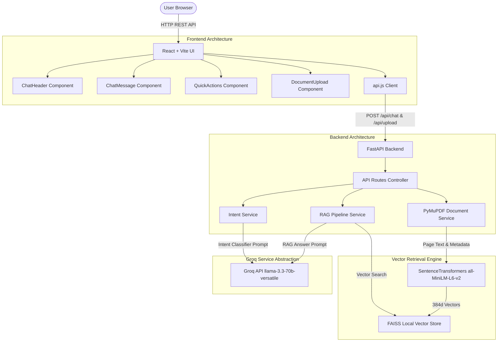

# Architecture & System Design

The **AI-Powered E-Commerce RAG Chatbot** is built using a modular, decoupled architecture consisting of a React + Vite frontend, a Python FastAPI backend, Sentence Transformers for embeddings, local FAISS for vector indexing, and Groq API for intent classification and answer generation.

## Component Overview Diagram

## RAG Ingestion & Query Workflow

1. **Document Ingestion**:
   - `PyMuPDF` parses PDF files page-by-page.
   - Text is split into overlapping chunks while preserving sentence boundaries.
   - Each chunk retains metadata: `{ filename, page_number, chunk_id, text }`.
   - `SentenceTransformers` (`all-MiniLM-L6-v2`) converts text chunks into 384-dimensional dense vectors.
   - Embeddings and metadata are indexed in local `FAISS` vector store (`data/vector_store/`).

2. **Intent Classification & Routing**:
   - Every user message is analyzed by Groq API into 8 intents: `faq`, `product_question`, `product_recommendation`, `review_summary`, `order_shipping`, `returns_refunds`, `general_support`, `unknown`.
   - Dedicated prompt templates adjust guardrails based on the intent (e.g., forbidding product recommendations not present in retrieved context).

3. **Context Retrieval & Generation**:
   - Query embedding is searched against FAISS index using cosine similarity.
   - Top-K relevant document chunks are selected.
   - Prompt is sent to Groq `llama-3.3-70b-versatile`.
   - Response text, detected intent label, and citation cards (filename + page number) are returned to React UI.
